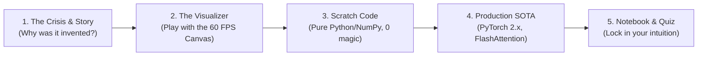

# 🧠 Synapse: Learn Neural Networks the Easy Way
### *From Absolute Zero to State-of-the-Art AI Research (1943 → 2026)*
by  @nnfuad

[](https://pytorch.org/)
[](https://numpy.org/)
[](https://vitejs.dev/)
[](https://react.dev/)
[](https://tailwindcss.com/)
[](file:///Volumes/LEXAR/Artificial%20Intelligence/Neural%20Networks/conftest.py)

Welcome to **Synapse**, an open-source, interactive, graphical learning platform designed to demystify neural networks for everyone. Whether you are a high school student with zero calculus background or a graduate researcher preparing to train modern Foundation Models, **Synapse** gives you the intuitive mental models, mathematical rigor, and production code needed to achieve true mastery.

---

## 🎓 How to Learn from This Tool: The Master Study Guide

Neural networks are often taught backwards: students are bombarded with abstract linear algebra and calculus before they understand *what physical problem the network is solving*.

In **Synapse**, every concept is taught through **The 5-Step Learning Loop**:



### Step 1: Discover the Historical Crisis (The "Aha!" Hook)
Every breakthrough in AI was born out of a catastrophic failure of the previous era:
- *Why did we invent the Perceptron in 1957?* Because McCulloch-Pitts neurons couldn't learn their own weights.
- *Why did the First AI Winter happen in 1969?* Because Minsky and Papert proved a single linear line can never solve XOR.
- *Why did we invent Transformers in 2017?* Because sequential RNNs could not be parallelized across GPUs.

*Start each module by reading the historical prelude so you understand the problem before seeing the solution.*

### Step 2: Play with the 60 FPS Interactive Visualizer
Before writing code or reading mathematical derivations, open the web visualizer (**`http://localhost:5173`**):
- **Drag the sliders**: Adjust learning rates, thresholds, and dimensions.
- **Watch the geometry**: See hyperplanes rotate, loss surfaces deform, attention spotlight beams illuminate tokens, and coordinate spaces twist.
- **Form the mental image**: Connect the sensory analogy (e.g. soundboard knobs, water pressure gauges, stenciled flashlights) to the visual canvas.

### Step 3: Deconstruct the Scratch Code (Tier 1: Pure Python & NumPy)
Open the corresponding script in `python/moduleXX/`:
- Every single equation—forward pass, analytical gradients, backward chain rule, AdamW moments, and attention matrices—is written from scratch using pure arithmetic.
- There are **zero black boxes** and no third-party framework magic. If you can do basic arithmetic, you can understand every line.

### Step 4: Scale to Production SOTA (Tier 2: Idiomatic PyTorch 2.x)
Once you understand the raw math, open the companion PyTorch script:
- Learn how modern AI research labs and production systems write clean, modular, hardware-accelerated code.
- Explore modern standards: `torch.autograd.Function`, Pre-LN RMSNorm, Grouped-Query Attention (GQA), Rotary Position Embeddings (RoPE), and FlashAttention (`F.scaled_dot_product_attention`).

### Step 5: Experiment in Jupyter Notebooks & Test Your Mastery
- Launch the companion Jupyter notebook in `notebooks/` to plot custom manifolds, visualize gradient norms, and complete student challenges.
- Take the interactive **Mastery Quiz** built directly into the web application to test your conceptual understanding before advancing to the next stage.

---

## ⚡ Quick Start: Run the Interactive Web Explainer Locally

Anyone can fire up the full graphical platform on their local machine in under 60 seconds:

```bash
# 1. Clone the repository
git clone https://github.com/nnfuad/Synapse-Learn-NN-the-Easy-Way.git
cd Synapse-Learn-NN-the-Easy-Way

# 2. Launch the interactive web platform
cd web
npm install
npm run dev
```

Open your browser to: **`http://localhost:5173`**

---

## 🐍 Python & PyTorch Laboratory

All 10 modules include runnable, self-contained Python scripts and companion Jupyter notebooks:

```bash
# 1. Install dependencies
pip install -r python/requirements.txt

# 2. Run the full automated verification test suite (79 tests across all 10 modules)
pytest

# 3. Explore any module script directly:
python3 python/module00_history_and_perceptron/rosenblatt_perceptron.py
python3 python/module01_computational_graphs_autograd/autograd_engine.py
python3 python/module02_optimization_and_loss_landscapes/optimizers_scratch.py
python3 python/module06_transformers_and_attention/transformer_block_pytorch.py
python3 python/module08_llm_reasoning_and_alignment/dpo_and_grpo_loss.py

# 4. Launch interactive Jupyter notebooks
jupyter notebook notebooks/
```

---

## 🗺️ The Complete 10-Stage Zero-to-SOTA Curriculum

| Module | Era | Historical Breakthrough | Core Physical Analogy | Interactive Visualizer | Scratch Tier | SOTA Tier |
| :---: | :---: | :--- | :--- | :--- | :---: | :---: |
| **[00](file:///Volumes/LEXAR/Artificial%20Intelligence/Neural%20Networks/python/module00_history_and_perceptron/)** | 1943–1969 | **Genesis & Perceptrons**: McCulloch-Pitts, Rosenblatt, & the XOR Crisis | Audio Mixer Knobs & Diagonal Fence Dilemma | 2D Decision Hyperplane + XOR Space Warp | NumPy | PyTorch 2.x |
| **[01](file:///Volumes/LEXAR/Artificial%20Intelligence/Neural%20Networks/python/module01_computational_graphs_autograd/)** | 1970–1986 | **Autograd & Backpropagation**: Linnainmaa, Werbos, & Rumelhart | Water Pipes with Reverse Hydraulic Pressure Gauges | Directed Acyclic Graph (DAG) Hydraulic Wave | Value Class | Custom Autograd |
| **[02](file:///Volumes/LEXAR/Artificial%20Intelligence/Neural%20Networks/python/module02_optimization_and_loss_landscapes/)** | 1950–2017 | **Optimization & Loss Geometry**: SGD, Polyak Momentum, Adam, & AdamW | Skiing Down a Foggy Ravine; Heavy Bowling Balls | 2D/3D Contour Landscape Marble Race | NumPy | AdamW + Cosine |
| **[03](file:///Volumes/LEXAR/Artificial%20Intelligence/Neural%20Networks/python/module03_generalization_and_normalization/)** | 2014–2019 | **Generalization & Normalization**: Inverted Dropout, BatchNorm, LayerNorm, RMSNorm | Musician Ensemble Muting & Factory Quality Control | Live Distribution Histograms & Dropout Strobe | NumPy | Pre-LN RMSNorm |
| **[04](file:///Volumes/LEXAR/Artificial%20Intelligence/Neural%20Networks/python/module04_spatial_vision_and_cnns/)** | 1998–2022 | **Spatial Vision & CNNs**: LeNet-5, VGG, ResNet Identity Shortcut, ConvNeXt | Stenciled Flashlight Scanning an Art Canvas | Interactive 2D Convolution Scanner & Skip Highway | im2col NumPy | ConvNeXt / ResNet |
| **[05](file:///Volumes/LEXAR/Artificial%20Intelligence/Neural%20Networks/python/module05_sequential_processing_and_attention/)** | 1997–2014 | **Sequential Dynamics & Attention**: LSTM Constant Error Carousel, Bahdanau Attention | Telephone Game with a Shrinking Notepad | Unrolled Memory Tape & French-English Attention Spotlight | NumPy LSTMCell | PyTorch Seq2Seq |
| **[06](file:///Volumes/LEXAR/Artificial%20Intelligence/Neural%20Networks/python/module06_transformers_and_attention/)** | 2017–2024 | **The Modern Transformer Revolution**: Multi-Head Attention, RoPE, KV-Cache, FlashAttention | Summit of Diplomats Trading Q, K, and V Envelopes | Live $Q \times K^\top \to V$ Spotlight & RoPE Dial | NumPy MHA | FlashAttention-2 |
| **[07](file:///Volumes/LEXAR/Artificial%20Intelligence/Neural%20Networks/python/module07_generative_diffusion_flow/)** | 2020–2024 | **Generative Paradigms**: DDPM Langevin Denoising & Optimal Transport Flow Matching | Dropping Ink in Water and Playing the Film in Reverse | 60 FPS Particle Simulation & Flow Vector Field | DDPM NumPy | OT-CFM Solvers |
| **[08](file:///Volumes/LEXAR/Artificial%20Intelligence/Neural%20Networks/python/module08_llm_reasoning_and_alignment/)** | 2022–2026 | **LLMs, Alignment & Reasoning**: Sparse MoE, Closed-Form DPO, Critic-Free GRPO | Socratic Debate Coach Scoring Rollouts | Live Token MoE Router & MCTS Reasoning Tree | Top-K Router | DeepSeek-V3 / R1 |
| **[09](file:///Volumes/LEXAR/Artificial%20Intelligence/Neural%20Networks/python/module09_mechanistic_interpretability/)** | 2024–2026 | **Mechanistic Interpretability**: Induction Circuits, Superposition & Sparse Autoencoders | MRI / Brain X-Ray of an Artificial Network | Induction Circuit Heatmaps & SAE Dictionary Plane | SAE Engine | Transformer Circuits |

---

## 🧪 Verification & Automated Testing

Every module is rigorously verified against reference implementations and numerical gradients:

```
============================= test session starts ==============================
collected 79 items                                                             

python/module00_history_and_perceptron/test_module00.py ......           [  7%]
python/module01_computational_graphs_autograd/test_module01.py ......... [ 18%]
python/module02_optimization_and_loss_landscapes/test_module02.py ........... [ 32%]
python/module03_generalization_and_normalization/test_module03.py ...... [ 40%]
python/module04_spatial_vision_and_cnns/test_module04.py .......         [ 49%]
python/module05_sequential_processing_and_attention/test_module05.py ........ [ 59%]
python/module06_transformers_and_attention/test_module06.py .......      [ 68%]
python/module07_generative_diffusion_flow/test_module07.py ..........    [ 81%]
python/module08_llm_reasoning_and_alignment/test_module08.py .........   [ 92%]
python/module09_mechanistic_interpretability/test_module09.py ......     [100%]

============================== 79 passed in 3.87s ==============================
```

---

## 🤝 Contributing & Community

Contributions are warmly welcomed! Whether you want to add a new visualization, implement a new research paper, optimize a GPU kernel, or fix a typo:
1. Fork the repository.
2. Create your feature branch (`git checkout -b feature/amazing-feature`).
3. Commit your changes (`git commit -m 'Add amazing feature'`).
4. Ensure all tests pass (`pytest && cd web && npm run build`).
5. Push to the branch (`git push origin feature/amazing-feature`).
6. Open a Pull Request.

---

## 📜 License

Distributed under the **MIT License**. See `LICENSE` for more information.
Designed with pedagogical passion for learners worldwide.
